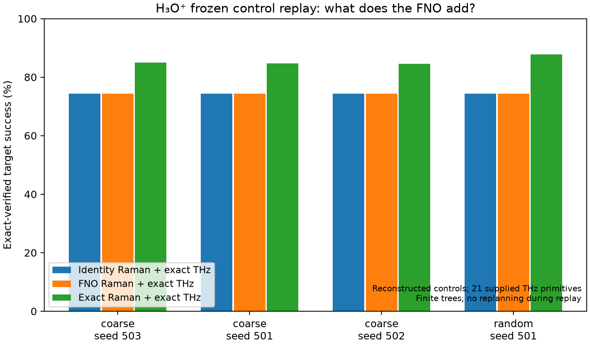
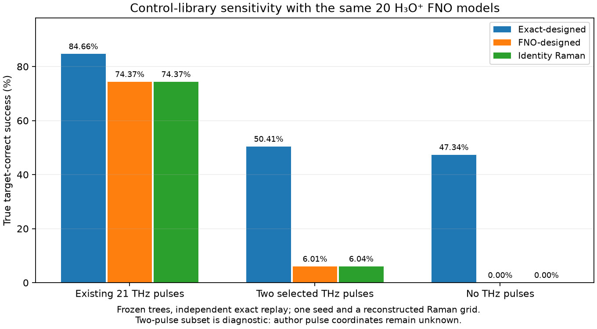
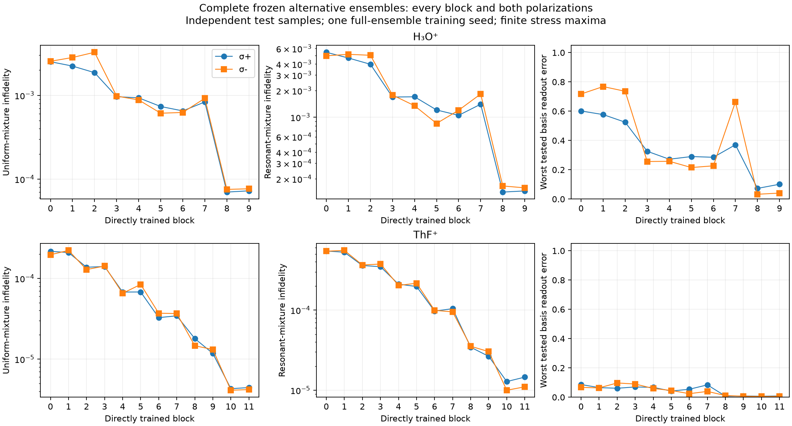

# What the H3O+ FNO replication established

Distilled from an independent adversarial review of this repo and of arXiv:2608.03702
(September 2026, ~150 NERSC jobs). The review's raw notes, job ledger and checkpoints were
deleted after this summary was written; the numbers below are the ones worth carrying into new
surrogate work. "Basis P1 error" = worst, over basis initial states and pulse times, of
|P(nu >= 1) predicted - exact| at a resonant control; it is the metric that predicts control
failure. "Identity Raman" = a surrogate that predicts no dynamics at all (p(tau) = p(0)).

## Verdict

| Claim | Status |
|---|---|
| Exact single-pulse propagation implements the supplied Hamiltonian | **Verified.** Independent matrix exponentials agree to ~1e-11 (H3O+), ~1e-10 (ThF+); Boltzmann priors to ~1e-13 |
| Fig. 3a reference trajectory | Reconciled (marker RMS ~4e-7) with a 40 K prior, an unrounded frequency and leading Lamb-Dicke coupling |
| Paper's FNO accuracy (median infidelity ~1e-4, p95 < 2e-3) | **Not reproduced.** Best clean reconstruction: median 1.5-1.9e-3, p95 up to 6.6e-3. The static predictor scores ~1e-4 on the same test |
| Paper's H3O+ control success shows learned Raman dynamics | **Refuted.** See below |
| Paper's training recipe is identifiable from the text | No: population law, pair count/construction, loss constants and library defaults are unspecified |
| CUDA-Q speedups, qMDP-DQN sweep | Not tested |

## The central result: H3O+ control success came from the THz pulses

With the 21 exact THz primitives, FNO-designed policies reach ~74.4% exact-verified success,
the identity-Raman surrogate reaches 74.38%, and exact Raman planning reaches ~84.7%. Tracing
the frozen trees shows only 2.5e-13 of the successful probability goes through any Raman pulse.
Removing the THz pulses leaves FNO and identity Raman at **zero** correct declarations,
against 47% for exact planning.

**Rule for any new surrogate:** always report it against both the identity-Raman baseline and
exact planning, with the same prior, primitives, pulse budget and seeds, and with all claimed
success coming from exact replay of the frozen policy. A high success rate, or a low
diffuse-mixture median infidelity, is not evidence of learned dynamics by itself.

## Why the per-block FNO fails on H3O+

1. **Memorising the population pool.** With a fixed pool of initial populations, block 0
   reconstructs training p(0) to TV ~0.009 but unseen p(0) only to TV ~0.30. Renewing
   populations every epoch fixes this particular failure (~38x better globally).
2. **Diffuse sampling never shows near-pure states.** For Dirichlet(1) over M states,
   P(max_i p_i >= q) = M (1-q)^(M-1). For the 40-state block 7, 200k draws have 1.5e-5
   probability of containing any p_i >= 0.5 and 8e-33 of any p_i >= 0.9 (64-state block 0:
   1.4e-12, 1.3e-56). Yet control beliefs *are* concentrated. This is why H3O+'s 40-64-state
   blocks fail where ThF+'s smaller blocks do not.
3. **Missing coverage is not the whole story.** One H3O+ failure had 21 training
   presentations with >0.9 population in the failing state within a linewidth, and still
   missed an excitation of ~0.55. The problem is also about generalisation across frequency.
4. **Softmax saturation under the paper loss (sqrt of weighted MSE).** The gradient on a
   logit scales with q itself, so a badly underestimated excited population suppresses its own
   correction; failed checkpoints showed logit gaps ~14. Cross entropy keeps a (q - y) gradient.
5. **Learning-rate exposure.** With StepLR(step 5, gamma 0.5) over 200 epochs, 83% of the
   summed learning rate falls in the first 25 epochs; the final LR is 4.6e-10. The unstated
   pairs-per-epoch therefore matters a lot.
6. **The raw FNO is not linear in the input mixture**, although the physics is. Enforcing
   linearity (predict basis columns, then mix) helps a well-trained ensemble (median 1.5e-3 ->
   2.6e-4) but makes a poor one *worse* (x6-8): it cannot repair wrong columns. Initial-time
   anchoring removes ~75% of the median error and none of the basis-transfer error.

## What helped, and by how much (block probes, 3 seeds)

Factorial over {broad vs transition-focused populations} x {paper RMS vs cross entropy} x
{StepLR every 5 vs 25 epochs}; selection frozen before the fresh test:

| Probe | Baseline worst basis P1 | Selected recipe | Selected worst basis P1 (3 seeds) |
|---|---:|---|---:|
| H3O+ block 7 | 0.993 | broad log-uniform Dirichlet(alpha in [1e-2, 1]), CE, step 25 | 0.38-0.58 |
| ThF+ block 0 | 0.48-0.52 | + 25% exact pure sources near a transition, CE, step 25 | 0.14-0.17 |

- The slow LR decay and the choice of objective account for most of the gain; focused
  pure-state sampling alone does not fix it.
- A 4x pair budget and larger activity weights (lambda 0-1000) mostly improve averages and
  leave the worst-case tails near 1 for H3O+.
- A local restart can fit any single failed trajectory (P1 error 0.9997 -> 0.005). The
  capacity is there; generalising across frequency and population is what fails.

Full ensembles trained with the selected recipes (20 H3O+ models, 24 ThF+ models, direct
training for each polarisation, no symmetry reuse):

- **H3O+:** the largest blocks (0-2) keep basis errors of 0.5-0.77. On the full system the
  median stays ~1.5e-3; with basis-column inference it drops to 2.6-4.1e-4.
- **H3O+ control without THz:** 8.1% correct-target success (raw) and 15.3% (basis-column),
  against 47.3% for exact planning. The Raman contribution is real but far from exact.
- **ThF+:** worst basis P1 error is 0.097 across all 24 models. The FNO beats identity Raman by
  +7.9 percentage points (coarse grid) and +13.7 (random grid), with a 4.4-point gap to exact
  planning on the random grid.

## Physics caveats that apply to any architecture

- **Motional cutoff.** H3O+ uses `n_nu = 2`. Single-pulse transfer columns change by up to
  0.95 between 2 and 8 levels at some resonances, but frozen-policy success moves by at most
  ~3 percentage points (FNO policies) and much less for exact ones; 8 and 12 levels agree to
  ~1e-14. Because nu - mF is conserved per sigma+ edge, 12 levels close the reachable ladder
  for H3O+ (mF in [-5.5, 5.5]). ThF+: 7 vs 13 levels differ by <= 6.6e-6.
- **Reset model.** The Bayes update drops coherences inside a measurement branch. This is
  harmless on the sampled resonances (<= 2.6e-6), but it is an assumption, not a result.
- **Purity threshold under surrogate error.** A predicted target population of 0.98 only
  certifies 0.98 - epsilon (epsilon = TV error). Conditioning on a branch of mass B amplifies
  the error to about epsilon / (B - epsilon), so rare branches are uninformative.
  Surrogate-declared success must be replayed exactly.
- **ThF+ inputs are estimates.** G_xx, G_yy and c_I are estimated, and the Rabi table assumes
  a single intermediate state. ThF+ conclusions hold within that effective model only.

## Code defects found (fixed in the working tree)

- `surrogate/train.py`: validation ignored `cfg.per_sample_sqrt`.
- `surrogate/dataset.py`: the split cache ignored `activity_lambda/eps` and the embedding
  constants (`s_emb`, `beta_emb`, `delta_max`, none of which are in the fingerprint). Changing
  them silently reloaded stale weights. Split names now hash all of them.
- `env/cache.py`: rounding omegas to 1e-9 could push a valid window endpoint outside the
  window.
- `policies/baselines.py`: with `n_pool` set, the planner kept only the best duration per drive
  *before* pooling, so the pool could hold a single action.

Open but not fixed: `replication/` stage 3 reuses runs keyed only by fingerprint, and
`s05_planner` stamps surrogates by manifest mtime rather than a content hash.

## Numbers to beat

For H3O+ with no THz pulses and exact replay: 47% correct-target success (exact planning), 15%
(best FNO here), 0% (identity Raman). Forward metrics: worst basis P1 error on the 40-64-state
blocks < 0.1 (ThF+ level), and a full-system median below the static predictor's ~1e-4.
